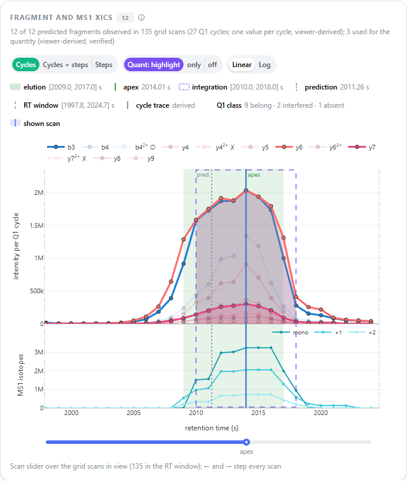
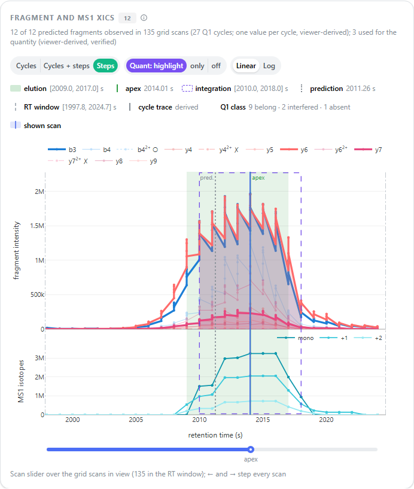
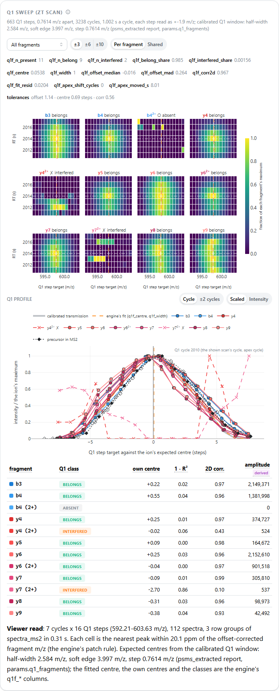

# User guide

`mumdia-viewer` shows what MuMDIA found in a run or an experiment, and why. It reads the
output directory and never writes to it.

## Install

```bash
pip install mumdia-viewer            # from a wheel or the repository: pip install .
```

You need Python 3.11 or newer. The dependencies are pyarrow, DuckDB, pandas, numpy, Dash,
dash-mantine-components, dash-ag-grid, Plotly and blake3. All are MIT, BSD or Apache-2.0
licensed. Nothing is fetched from the internet at run time.

## Start

```bash
mumdia-viewer <run-or-experiment-dir> [--fasta proteins.fasta] [--compare <other-dir>] [--port N]
```

| Option | What it does |
|---|---|
| `--fasta PATH` | Protein sequences for the coverage views. The option can be repeated. Without it, the viewer uses the FASTA that a run searched from a FASTA recorded, if that file is still there. |
| `--compare DIR` | A second result set for the compare view. It is served as a full viewer at `<address>b/`. |
| `--port N` | The port; the default is the first free port from 8050. |
| `--no-browser` | Do not open a browser (use it on a server). |
| `--remap OLD=NEW` | Inputs recorded under `OLD` are now under `NEW`. |
| `--host` | The address to bind. The default is 127.0.0.1; any other value exposes the viewer to the network. |
| `--no-token` | Serve at `/` instead of a random path. Use it only on a single-user machine. |
| `--engine PATH` | A MuMDIA binary (default: the `MUMDIA_BIN` environment variable). On a diaPASEF run the precursor page then reads the raw mobilogram from the `.d` with `mumdia mobilogram`. The desktop application sets `MUMDIA_BIN` to its own engine. |
| `--memory-limit SIZE` | The memory limit of the viewer's DuckDB databases, for example `8GB`, `1.5GiB` or `50%` of the physical memory (default: the `MUMDIA_VIEWER_MEMORY_LIMIT` environment variable, else a quarter of the physical memory, at least 1 GiB and at most 16 GiB). Each opened result set has its own database, so a comparison uses up to twice the limit. The viewer prints the limit it uses when it starts. |

**On a remote server**, start the viewer with `--no-browser`. Then forward the port:
`ssh -L <port>:127.0.0.1:<port> <user>@<server>`. Open the printed address, including
its token, on your own machine.

## Rules the viewer keeps

- **Engine columns.** Every number is one of MuMDIA's columns. A number the viewer computes
  is marked "derived" or "viewer". Examples: a percentile, a coverage, a CV, a TIC, or a
  spectrum match outside the engine. No q value is ever recomputed.
- **Counts.** Every count names its row unit and its q column, for example
  "81,310 peptides (unique base_peptide_id, peptide_q_value ≤ 0.01)". The q threshold in
  the header applies everywhere.
- **Grouped q columns.** `precursor_q`, `peptide_q_value` and `pg_q_value` are set on each
  group's winning row only. In an experiment they are experiment-wide. Per-run counts use
  `run_psm_q`.
- **Decoys and quantities.** Decoys are hidden in the identification tables, with a switch
  to show them. A missing quantity is "not quantifiable" or "not selected", never 0.
- **Retention times** are in seconds.

## Pages

| Page | What it shows |
|---|---|
| **Overview** | Version, configuration, inputs and stage timings. Counts per unit, with a threshold slider that shows exact counts at each stop. Identification curves, score distributions and per-run counts. The engine-report check. A **Report** button downloads a static, offline HTML file. |
| **Identifications** | Linked panels, as in PeptideShaker's Overview: protein groups, then the peptides of the selected group (with sequence coverage), then the precursors of the selected peptide, then a preview of the selected precursor. Click or use the arrow keys to select; Enter opens the precursor page. **TSV** downloads every row under the filters. |
| **Precursor detail** | Why one identification was accepted. Fragment and MS1 XICs linked to the spectrum mirror: click a scan, or use the slider or the ← → keys. The fragmentation diagram and the ion table. On a diaPASEF run, the 1/K0 of the traces and the mobilogram of the shown scan's frame (raw events through the engine, or the converted centroids). On a ZT Scan DIA run, XICs with one value per Q1 cycle and the Q1 sweep card ([below](#zt-scan-dia-runs)). Every q value with its unit and winner, evidence cards with percentiles, the base-peptide competition, the decoy partner, quantification, coverage, and your verdict. |
| **Protein** | A protein group: its members, a verdict strip, linked peptides and precursors, sequence coverage, and the quantity per run (experiments). |
| **Calibration** | RT anchors rebuilt with the engine's rule and checked against `cal.json`. The fitted map and the window. In-sample residuals, which are fit diagnostics, not error estimates. The RT error of accepted identifications. Fragment mass calibration. |
| **Run QC** | TIC and base peak, identifications across RT, scan rate, isolation windows, peaks per MS2 spectrum (the `--top-peaks-ms2` check), and the charge, length, missed-cleavage and modification distributions. |
| **Quant QC** | Quantity distributions, missing values, quant states, CVs within conditions, the LFQ matrix and protein profiles. Conditions are suggested from the mzML names and can be edited. |
| **Condition ratios** | log2 A/B per species (by protein-name suffix), with expected ratios you enter. |
| **Spectrum browser** | Any scan by index or RT, stepping within its window, and the candidates near it with their fragment matches. |
| **Across runs** | One precursor in every run of an experiment: XICs, quantities with MBR transfers, q values, and a run x fragment map of the fragment areas with the fragments each quantity used outlined. Open it from the precursor page. |
| **Compare** | Two result sets: overlap per unit, score and quantity scatters, and the identifications unique to each side, with links into both viewers. It also shows configuration differences. |
| **Notes** | Your verdicts. Give one on the precursor page (keys A accepted, R rejected, U unsure, or the card). Export them as TSV or JSON. |

Screenshots: [screenshots/m2](screenshots/m2) and [screenshots/views](screenshots/views).

## ZT Scan DIA runs

In a SCIEX ZT Scan DIA run the quadrupole sweeps the precursor range once a cycle in steps
far narrower than its window: on the ZenoTOF method 663 steps 0.76 m/z apart, a 3.8 m/z
window, one cycle a second. A precursor passes through five to seven consecutive steps of
every cycle, and each step is an MS2 spectrum of its own at a different transmission. The
engine's chromatogram holds one sample per step, so a trace drawn through every sample is a
sawtooth: five samples a few milliseconds apart, each at its own transmission, then a second
to the next cycle.

The viewer recognises a ZT Scan run by its `spectra_ms2` (version 3 records the Q1 sweep,
`q1_cycle` and `q1_step`; MuMDIA 0.12 and later). Every other run looks and behaves as
before. On a ZT Scan run the precursor page changes in three places.

**The XIC, one value per Q1 cycle.** The default view, **Cycles**, collapses the steps of
each cycle into one value: `sum(w x) / sum(w^2)` over the cycle's covering steps, where `x`
is the step's sample and `w` the fragment's calibrated Q1 transmission at the step,
including the precursor's isotope envelope, at the candidate's expected Q1 centre. This is
the estimator of the engine's `quant.q1_fragments`, so the value is the fragment's
intensity at full transmission; it is drawn at the mean retention time of the cycle's
samples. The values are viewer-derived and say so. **Cycles + steps** adds the per-step
samples faintly behind them; **Steps** shows the samples alone, as on any other run. A
click on a cycle shows the cycle's middle step in the spectrum mirror. When the engine
wrote cycle-level traces itself (`extract.q1_traces`: `chromatograms_q1.parquet` beside the
run's `chromatograms.parquet`, chromatograms version 5 or 6) the XIC draws those as the
engine's cycle traces, and the step samples behind them still come from
`chromatograms.parquet`, which keeps the per-step traces that quant integrates. A candidate
the cycle-trace table does not hold falls back to the viewer's collapse, with a note. (A
development build of the engine wrote the cycle traces into `chromatograms.parquet` itself;
such a run shows them with no step samples to switch to.) With the separable
RT x Q1 model (`features.q1_separable`, `psms_extracted` version 9) each fragment's model
trace, `q1s_frag_amp` x `q1s_elution`, is drawn dotted.

Each fragment keeps its colour; its line and marker give the engine's per-fragment Q1
decision (`q1f_frag_class` of `psms_extracted`): solid with a filled circle, the fragment
**belongs** (its own Q1 centre is where the calibrated window puts the precursor and it
co-elutes); dashed with ✗, **interfered** (present, but centred elsewhere in Q1 or not
co-eluting: another precursor's signal at this m/z); dotted with ○, **absent**. The marker
key says what the apex and the bounds are on this run: `apex_rt`, `elution_lo` and
`elution_hi` are the engine's columns, retention times of single spectra (Q1 steps), and
quant integrated the per-step samples over the engine's window in Q1 cycles
(`quant.q1_cycle_halfwidth`).

**The Q1 sweep card.** Beside the XIC, under its own title:

- *The engine's numbers*: the candidate's `q1f_*` columns (fragments present, belonging and
  interfered, the shared Q1 centre and width, the 2D correlation, the apex shift and the
  Q1 re-pick) and the decision's tolerances, each with its column name.
- *The patch*: for every fragment an RT x Q1-step heatmap of the cycles around the apex
  (±3, the cycles the engine's decision reads; ±6 or ±10 on request) by the steps within the
  calibrated window's reach of the expected centre plus two steps either side. A cell holds
  the peak nearest the offset-corrected fragment m/z within the extraction's fragment
  tolerance in that step's spectrum, the engine's rule. The white line is the fragment's
  expected Q1 centre, the orange dashed line the engine's fitted shared centre, the pink
  dotted line the fragment's own centre; the dash-dot line marks the apex cycle and a
  dotted one the decision's 2D apex when it differs. A fragment that belongs lights up
  where the lines meet; an interfered one lights up elsewhere. Choose one fragment to see
  it beside the unfragmented precursor's M0 in MS2. **Per fragment** scales each heatmap to
  its own maximum, **Shared** all to the largest.
- *The Q1 profile* of the shown scan's cycle (the apex cycle when the page opens; **±2
  cycles** sums two cycles either side, as the decision sums its profiles): each fragment's
  intensity across the steps, against its own expected centre and scaled to its maximum,
  over the calibrated transmission (grey) and the engine's fit (orange, dashed); the
  precursor's own isotopes in MS2 are the black diamonds. **Intensity** shows the raw
  values against the step target, each fragment's expected profile scaled by its
  least-squares amplitude as a dotted line.
- *The decisions*: per fragment its class, its own Q1 centre, residual and 2D correlation
  (the engine's lists, and the separable model's R² and interference share when present)
  and its amplitude at the shown cycles (viewer-derived).

The card follows the shown scan: a scan outside the patch's cycles centres the patch on its
cycle. The patch is read from the spectra after the page has appeared: only the row groups
of `spectra_ms2` that hold its cells (three for ±3 cycles on the K562 runs, whose 3.3 billion
peaks fill about a thousand row groups), read in parallel, and the cell spectra are kept in
a 96 MiB cache, so a wider span or a revisit reads nothing again. On a shared server with a
busy disk the first patch of a candidate took 0.3 to 3 s, every later one a few
milliseconds.

| Cycles (the default) | Steps (the engine's samples) | The Q1 sweep card |
|---|---|---|
|  |  |  |

The screenshots show IDIIPNPQER (2+) of a K562 run on a ZenoTOF 8600 (MuMDIA 0.12.0): the
same twelve fragments as one value per cycle and as the per-step sawtooth, and the patches
in which y4 (2+) and y7 (2+), which the engine calls interfered, light up away from the
apex where the other fragments do.

## Where the viewer keeps its files

| What | Where |
|---|---|
| Cache (derived data, safe to delete) | `MUMDIA_VIEWER_CACHE_DIR`, else `%LOCALAPPDATA%\mumdia-viewer` on Windows, `~/Library/Caches/mumdia-viewer` on macOS, `~/.cache/mumdia-viewer` on Linux |
| Validation notes (your data) | `MUMDIA_VIEWER_NOTES_DIR`, else `%APPDATA%\mumdia-viewer\notes` on Windows, `~/Library/Application Support/mumdia-viewer/notes` on macOS, `~/.local/share/mumdia-viewer/notes` on Linux. There is one JSON file per result set, keyed by the content hash of its scored table. |
| Browser settings (theme, conditions, expected ratios) | The browser's local storage |
| DuckDB spill files (while a query needs more than the memory limit) | A private directory under the cache, else under the system's temporary directory; removed when the viewer stops |

## From Python

The data layer works without the UI, for example in a notebook. See the
[README](../README.md) and [data-layer.md](data-layer.md).

## Troubleshooting

- **"not a result directory"**: open the directory that holds `manifest.json` (a run) or
  `experiment_manifest.json` (an experiment).
- **Coverage says "start the viewer with --fasta"**: the run was searched with a spectral
  library. Pass the FASTA the library was built from.
- **An input shows "needs remap"**: the run directory or its inputs moved. Pass
  `--remap <old prefix>=<new prefix>`.
- **The first visit of a page is slower**: the viewer builds indexes and caches, such as
  the MS2 TIC or the candidate index, and keeps them in its cache directory.
- **"Out of Memory Error" in a table or a card**: a query needed more than the viewer's
  DuckDB memory limit, which the message states. Start the viewer with a higher limit,
  `--memory-limit 8GB` (or `50%`), or set `MUMDIA_VIEWER_MEMORY_LIMIT` before it starts;
  a viewer that the desktop application starts inherits the variable from the
  application's environment. The limit bounds DuckDB only: the rest of the viewer uses
  some hundreds of MB more.
